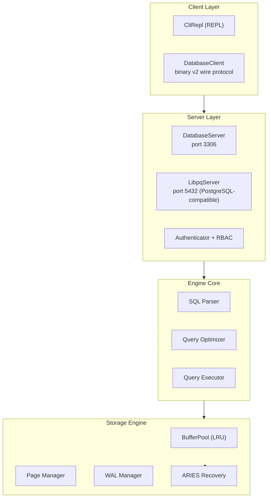

# DieselDB v3.4 — what's inside (overview)

DieselDB is a **production-grade Java database engine** that implements modern database engineering practices with a focus on reliability, performance, and security. This project demonstrates advanced concepts like ARIES crash recovery, write-ahead logging, multi-version concurrency control, and online schema changes.

## 🎯 Quick Start

```bash
# Clone and build
git clone https://github.com/Reider85/dieseldb.git
cd dieseldb
make compile
make test

# Start the database server
./start-server.sh

# Connect via CLI
./start-client.sh
```

## 🏗️ Architecture Overview

DieselDB implements a comprehensive database architecture with multiple storage backends, MVCC transactions, and PostgreSQL-compatible protocols:



## ✅ Production-Implemented Features

### Core Database Engine
- **SQL DDL/DML/DQL**: `CREATE/DROP/ALTER TABLE`, `INSERT/UPDATE/DELETE`, `SELECT` with 7 JOIN types, `GROUP BY`, `HAVING`, `ORDER BY`, `LIMIT/OFFSET`
- **Transactions**: Full ACID support with `BEGIN/COMMIT/ROLLBACK`, savepoints, 4 isolation levels
- **Indexes**: 6 types - BTree, Hash, Unique, Composite, Covering, Clustered
- **Online Schema Changes**: `ALTER TABLE` with `DEFAULT/COPY/INPLACE` algorithms and `NONE/SHARED/EXCLUSIVE` lock modes

### Advanced Features
- **ARIES Recovery**: Complete three-phase recovery (Analysis → Redo → Undo) with crash safety
- **MVCC with SSI**: Multi-version concurrency control with Serializable Snapshot Isolation
- **WAL with Group Commit**: Segmented write-ahead logging with async writer and 5ms batching
- **5 Storage Backends**: In-memory, CSV, TSV, JSONL (streaming + delta compaction), AVRO (full ecosystem)
- **PostgreSQL Protocol**: libpq-compatible server (port 5432) with SCRAM-SHA-256 authentication
- **Security**: RBAC with 8 actions, TLS 1.3/1.2, mTLS, SNI multi-tenant support
- **Replication**: Physical streaming replication with slots and synchronous standby support
- **Observability**: JMX MBeans, Prometheus metrics, health checks, audit logging

### Developer Experience
- **5 Official Drivers**: JDBC, Python, Node.js, Go, Rust with PostgreSQL compatibility
- **CLI Tools**: Interactive REPL with commands for backup, restore, and administration
- **Testing**: 368 test classes covering all subsystems with comprehensive coverage
- **Documentation**: Javadoc API documentation with [auto-deployed site](https://reider85.github.io/dieseldb/)

## 🚧 In Active Development

The project is actively working toward v1.0.0 stable release with planned features:
- Logical replication with auto-failover
- FOREIGN KEY / CHECK / NOT NULL constraints
- JSON column type with binary storage
- Window functions and CTE support
- Stored procedures and triggers

## 📊 Project Statistics

- **Code Base**: 444 main classes + 368 test classes ≈ 112K lines
- **Test Coverage**: Comprehensive unit and integration tests
- **Storage Backends**: 5 different storage engines (in-memory, CSV, TSV, JSONL, AVRO)
- **Network Protocols**: Binary v2, libpq v3, legacy v1 (deprecated)
- **Performance**: SIMD-vectorized aggregates, O(1) BufferPool eviction, adaptive query optimization

## 🤝 Community & Support

- **Discussions**: [Join our community discussions](https://github.com/Reider85/dieseldb/discussions) for Q&A, feature ideas, and use case sharing
- **Issues**: [Report bugs and request features](https://github.com/Reider85/dieseldb/issues)
- **Contributing**: We welcome contributions! See [CONTRIBUTING.md](https://github.com/Reider85/dieseldb/blob/main/CONTRIBUTING.md) for guidelines
- **Good First Issues**: Look for `good first issue` labeled items to get started

## 🌟 Star This Repository

If you find DieselDB useful for your projects or interesting as a database engine implementation, please give us a ⭐ star! This helps others discover the project and supports our development efforts.

**Star this repo if you find this useful — it helps others discover DieselDB.**

---

*DieselDB is developed by Reider85 (Vasiliy Zhila) with support from the AI community in an AI-driven, prompt-by-prompt workflow approach.*