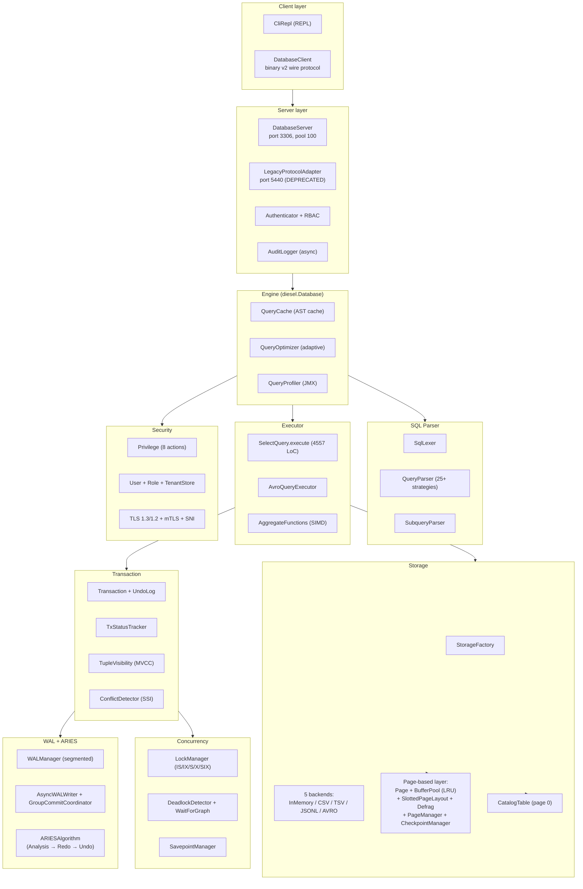

# DieselDB

> **Production-grade Java database engine with ARIES recovery, WAL, page-based storage, online schema changes, and SSI concurrency control**
>
> Production-grade база данных на Java 21 (LTS) с фокусом на современных DB-engineering практиках: ARIES crash recovery, segmented WAL с group commit, page-based storage с BufferPool (LRU eviction), MVCC с SSI для SERIALIZABLE, online `ALTER TABLE` (DEFAULT/COPY/INPLACE + LOCK), RBAC + TLS/mTLS/SNI multi-tenant, async audit log.

[](https://openjdk.org/projects/jdk/21/)
[](https://maven.apache.org/)
[](#releases)
[](https://github.com/Reider85/dieseldb/actions)
[](https://github.com/Reider85/dieseldb/stargazers)
[](#license)

> 🚀 **Status:** Production-like. Under active development toward v1.0.0 stable release. See [§ Development Status](#development-status) and [§ Roadmap](#roadmap).

---

## Table of Contents

- [Overview](#overview)
- [Key Features](#key-features)
- [Architecture](#architecture)
- [Quick Start](#quick-start)
- [SQL Reference](#sql-reference)
- [Storage Backends](#storage-backends)
- [Transactions & MVCC](#transactions--mvcc)
- [Indexes](#indexes)
- [Online Schema Changes](#online-schema-changes)
- [WAL & ARIES Recovery](#wal--aries-recovery)
- [Network Protocol](#network-protocol)
- [Security: RBAC, TLS, Audit](#security-rbac-tls-audit)
- [Backup & Restore](#backup--restore)
- [Configuration](#configuration)
- [Build & Test](#build--test)
- [Project Structure](#project-structure)
- [Development Status](#development-status)
- [Roadmap](#roadmap)
- [Contributing](#contributing)
- [Releases](#releases)
- [License](#license)
- [Acknowledgments](#acknowledgments)

---

## Overview

DieselDB — это production-grade встраиваемая (embedded) и клиент-серверная СУБД, написанная на Java 21 (LTS). Проект реализует современную архитектуру production БД с акцентом на надёжность, производительность и security:

- **ARIES recovery** (Analysis → Redo → Undo) с 25+ тест-классами, покрывающими crash-сценарии
- **Segmented WAL** с CRC32C checksums, group commit (5ms / 64 batch), async writer с 4 fsync policies
- **Page-based storage** с BufferPool (LRU eviction, pin/unpin), slotted page layout, tombstone reuse, defrag
- **5 storage backends**: in-memory, CSV, TSV, JSONL (streaming + block manager + delta compaction), AVRO (с отдельной экосистемой из 57 классов)
- **MVCC** с tuple-level versioning (`xmin`/`xmax`/`commandId`), SSI `ConflictDetector` для SERIALIZABLE
- **Granular LockManager** с 5 modes (IS/IX/S/X/SIX) + `WaitForGraph` deadlock detector (daemon thread + cycle detection + victim selection)
- **Online `ALTER TABLE`** полностью (DEFAULT/COPY/INPLACE + LOCK=NONE/SHARED/EXCLUSIVE + `DualWriteCoordinator`)
- **6 типов индексов**: BTree, BTreeClustered, CompositeBTree, CoveringBTree (index-only scans), Hash, Unique
- **RBAC** с 8 actions (SELECT/INSERT/UPDATE/DELETE/CREATE/DROP/ALTER/ADMIN), users, roles, tenants
- **TLS 1.3/1.2 AEAD-only** + mTLS + SNI multi-tenant (cipher whitelist, не deny-list — соответствует SSL Labs A+)
- **Async audit log** с bounded queue + retention + gzip archive
- **Binary wire protocol v2** с 21 message types, CRC32 footer, ZSTD/GZIP compression
- **7 JMX MBeans** для monitoring (BufferPool, BufferPoolFlusher, CheckpointManager, RecoveryManager, QueryProfiler, WALWriter, AsyncWALWriter, GroupCommitCoordinator)
- **SIMD-vectorized aggregates** (COUNT/MIN/MAX/AVG/SUM через `jdk.incubator.vector`)
- **Adaptive Query Optimizer** с plan cache (LRU) и fingerprint normalization

### Why DieselDB?

DieselDB — это **production-grade database engine**, реализующий:

- Page-based storage engine с BufferPool LRU (как в InnoDB / Postgres shared_buffers)
- ARIES recovery с полной трёхфазной реализацией (Analysis → Redo → Undo)
- MVCC с SSI conflict detection (как в Postgres Serializable Snapshot Isolation)
- Online schema changes с dual-write coordinator (как в MySQL 8.0+)
- Multi-tenant TLS с SNI-based keystore routing (как в современных enterprise API gateways)

Проект находится в активной разработке (current version `3.3.61`), движется к v1.0.0 stable release. Основные subsystems (storage, WAL, recovery, concurrency, security, network) — production-implemented и покрыты test-suite из 295 test-классов. Часть high-level features (JDBC driver, replication, FK constraints, JSON type) — в active development, см. [§ Roadmap](#roadmap).

---

## Key Features

### ✅ Production-Implemented (готово к использованию)

| Category | Реализация в коде |
|---|---|
| **SQL DDL** | `CREATE TABLE`, `DROP TABLE`, `ALTER TABLE ADD/DROP COLUMN`, `CREATE INDEX` (6 типов), `CREATE USER`, `CREATE ROLE`, `CREATE TENANT`, `GRANT`, `REVOKE`, `ALTER USER` |
| **SQL DML** | `INSERT INTO ... VALUES`, `INSERT INTO ... SELECT`, `UPDATE`, `DELETE` |
| **SQL DQL** | `SELECT` с `WHERE` (11 операторов), 7 `JOIN` типов, `GROUP BY`, `HAVING` (агрегаты), `ORDER BY`, `LIMIT`/`OFFSET`, `DISTINCT`, `AS`, scalar+IN-list subqueries, derived tables |
| **Transactions** | `BEGIN`, `COMMIT`, `ROLLBACK`, `SAVEPOINT`, `RELEASE SAVEPOINT`, `ROLLBACK TO SAVEPOINT`, `SET AUTOCOMMIT`, `SET TRANSACTION ISOLATION LEVEL`, `BEGIN BATCH` / `END BATCH` |
| **Isolation levels** | `READ_UNCOMMITTED` (default), `READ_COMMITTED`, `REPEATABLE_READ`, `SERIALIZABLE` — см. [Development Status](#development-status) про semantics polishing |
| **Indexes** | 6 типов: `BTREE`, `UNIQUE`, `HASH`, `UNIQUE CLUSTERED`, `COMPOSITE`, `COVERING` (+ `AVRO` для Avro storage) |
| **Meta** | `SHOW TABLES`, `SHOW CREATE TABLE`, `SHOW CREATE INDEXES` |
| **Admin** | `EXPLAIN [ANALYZE]`, `ANALYZE TABLE`, `VACUUM`, `VACUUM TABLE`, `ALTER STATUS`, `/* MAX_ROWS=N */` hint |
| **Prepared statements** | Server-side (`?`-placeholders, LRU plan cache, Prompt 79) |
| **Server-side cursors** | `OPEN_CURSOR`, `FETCH_CURSOR`, `CLOSE_CURSOR` (Prompt 81) |
| **Storage backends** | `in_memory` (default), `csv`, `tsv`, `jsonl` (streaming + block + delta), `avro` (57-классовая подсистема) |
| **Compression codecs** | `zstd`, `lz4`, `snappy` (для CSV/TSV/JSONL); `BZip2`, `Deflate`, `Snappy optimized`, `ZStandard` (для AVRO) |
| **Crash recovery** | ARIES (Analysis → Redo → Undo), segmented WAL, group commit, async writer, 4 fsync policies, WAL archiver, checkpoint manager |
| **Concurrency** | MVCC (tuple-level), SSI `ConflictDetector`, `LockManager` (5 modes IS/IX/S/X/SIX), `WaitForGraph` deadlock detector (daemon), `LockTimeoutManager`, `SavepointManager` + nested stack |
| **Online ALTER** | `ALGORITHM=DEFAULT/COPY/INPLACE` + `LOCK=NONE/SHARED/EXCLUSIVE`, `DualWriteCoordinator`, `ALTER STATUS` для мониторинга, `Database.cancelAlter()` |
| **Security** | RBAC (8 actions, users, roles, tenants), `Authenticator` + `PasswordHasher` (constant-time), `Session`/`SessionToken`, async `AuditLogger` (bounded queue + 90d retention + gzip archive) |
| **TLS** | TLS 1.3/1.2 AEAD-only, mTLS (`none`/`request`/`require`), SNI multi-tenant (per-hostname keystore) |
| **Network** | Binary protocol v2 (DSEL magic, CRC32, 21 message types), ZSTD/GZIP wire compression, legacy v1 protocol on port 5440 (deprecated, scheduled for removal) |
| **Backup** | `PhysicalBackup` + `PhysicalRestore` (с `BackupManifest` JSON + checksums), `AvroBackupManager` + `AvroRestoreManager` (полные для Avro storage) |
| **Monitoring** | 7 JMX MBeans (`diesel:type=...`), `QueryProfiler` с per-phase breakdown (parse/plan/execute/sort), slow query log |
| **Query optimizer** | Adaptive (`QueryOptimizer`, Prompt 82) с LRU plan cache + fingerprint normalization + replan threshold (0.5 / 2.0) |
| **Aggregates** | `COUNT`, `MIN`, `MAX`, `AVG`, `SUM` — SIMD-vectorized через `jdk.incubator.vector` |
| **Schema versioning** | `SchemaVersion` (immutable), `SchemaVersionRegistry` (bounded history + pin-based protection), `AlterAlgorithm` enum, `AlterLockMode` enum |
| **CLI** | `CliRepl` interactive REPL с командами `HELP`, `DUMP`, `BACKUP`, `PHYSICAL-RESTORE`, `RESTORE` |

### 🚧 In Active Development (planned for v1.0.0)

- JDBC driver (`java.sql.Driver` implementation)
- Replication (streaming + logical + sync standby)
- FOREIGN KEY / CHECK / NOT NULL / DEFAULT constraints
- JSON column type (binary JSONB-like storage)
- CTE / WITH / recursive CTE
- UNION / INTERSECT / EXCEPT
- Window functions (OVER, PARTITION BY, ROW_NUMBER, RANK)
- Stored procedures / functions / triggers
- Geo / spatial types
- BLOB / CLOB / TEXT / VARCHAR / DECIMAL(p,s) / TIMESTAMP / INTERVAL / ARRAY / MAP / ENUM

См. [§ Roadmap](#roadmap) для полного списка planned features.

---

## Architecture



### Главные пакеты

| Package | .java файлов | Роль |
|---|---|---|
| `diesel` (root) | 116 | Engine core: `Database`, `QueryParser`, `SelectQuery`, `Index` types, `Table` |
| `diesel.storage` | 34 | `StorageFactory`, `RowStorage` interface, all 5 backends, `CompressionFactory` |
| `diesel.storage.avro` | 57 | AVRO subsystem: `AvroRowStorage`, `AvroBackupManager`, `AvroRecoveryManager`, `AvroBloomFilter`, `SchemaEvolutionManager`, etc. |
| `diesel.storage.page` | 26 | Page-based: `Page`, `BufferPool`, `PageManager`, `SlottedPageLayout`, `CatalogTable`, JMX MBeans |
| `diesel.storage.json` | 15 | Streaming JSON (library-neutral): `JsonStreamParser`, Jackson/Gson adapters |
| `diesel.storage.tablespace` | 3 | `Tablespace` + `TablespaceFile` + `TablespaceRegistry` (in development) |
| `diesel.net` | 12 | `WireProtocol`, `MessageType`, TLS handlers, compression handshake |
| `diesel.net.messages` | 37 | Wire-сообщения v2 + codecs (21 message type) |
| `diesel.security` | 23 | RBAC (`Privilege`, `User`, `Role`, `TenantStore`), `Authenticator`, `AuditLogger` |
| `diesel.wal` | 19 | `WALManager`, `WALSegment`, `AsyncWALWriter`, `GroupCommitCoordinator`, `WALArchiver` |
| `diesel.recovery` | 13 | ARIES: `ARIESAlgorithm`, `AnalysisPhase`, `RedoPhase`, `UndoPhase`, checkpoint |
| `diesel.concurrency` | 13 | `LockManager`, `DeadlockDetector`, `WaitForGraph`, `ConflictDetector`, `SavepointManager` |
| `diesel.backup` | 10 | `DieselBackup`, `PhysicalBackup`, `LogicalDump` (in development), `BackupManifest` |
| `diesel.schema` | 5 | `SchemaVersion`, `SchemaVersionRegistry`, `AlterAlgorithm`, `AlterLockMode` |

**Итого: 383 main-класса + 295 test-классов ≈ 97 698 строк кода.**

---

## Quick Start

### Requirements

- JDK 21+ (verified with JDK 21 LTS)
- Maven 3.9+ (or use Maven bundled with IntelliJ IDEA)

### Build from source

```bash
git clone https://github.com/Reider85/dieseldb.git
cd dieseldb

# Quick test (smoke tests only)
mvn test

# Full test suite (all test classes)
mvn -Ptest test

# Build JAR
mvn package

# Install to local Maven repository
mvn install
```

### Start server

```bash
# Linux/macOS
./start-server.sh

# Windows
start-server.bat
```

Default port: **3306** (binary protocol v2), legacy port: **5440** (deprecated Java Object Serialization — disable in production).

### Connect via CLI client

```bash
# Linux/macOS
./start-client.sh

# Windows
start-client.bat
```

Interactive REPL prompt: `diesel> `

### Embedded mode (in-process)

```java
import diesel.Database;
import diesel.DieselDatabase;

// Create in-memory database (default)
Database db = new Database();

// Or with persistent storage
Database db = new Database("/path/to/data/dir");

// Execute SQL
Object result = db.executeQuery("SELECT * FROM users WHERE age > 18", null);

// With explicit transaction
UUID txId = db.beginTransaction(IsolationLevel.READ_COMMITTED);
db.executeQuery("INSERT INTO users (name, age) VALUES ('Alice', 30)", txId);
db.executeQuery("UPDATE users SET age = 31 WHERE name = 'Alice'", txId);
db.executeQuery("COMMIT", txId);

db.close();
```

### Network mode (client-server)

```java
import diesel.DatabaseClient;

DatabaseClient client = new DatabaseClient("localhost", 3306, "admin", "password");
client.connect();

Object result = client.executeQuery("SELECT name, age FROM users WHERE active = TRUE");

// Prepared statement
String stmtId = client.prepareStatement("SELECT * FROM users WHERE age > ? AND name LIKE ?");
Object rs = client.executePrepared(stmtId, 18, "Al%");

// Server-side cursor
String cursorId = client.openCursor("SELECT * FROM large_table", 1000);
List<Map<String,Object>> batch = client.fetchCursor(cursorId);
client.closeCursor(cursorId);

client.disconnect();
```

---

## SQL Reference

### Поддерживаемые типы данных (14 типов)

```sql
CREATE TABLE users (
  id           INTEGER PRIMARY KEY,
  name         STRING,
  email        STRING,
  age          INTEGER,
  score        BIGDECIMAL,
  balance      BIGDECIMAL,
  active       BOOLEAN,
  user_code    STRING,
  created      DATETIME,
  created_ms   DATETIME_MS,
  uuid         UUID,
  level        SHORT,
  byte_val     BYTE,
  long_val     LONG,
  float_val    FLOAT,
  double_val   DOUBLE,
  char_val     CHAR,
  seq_val      INTEGER SEQUENCE(seq1 1 1)
);
```

> 🚧 **In development** (planned for v1.0.0): `VARCHAR`, `NVARCHAR`, `DECIMAL(p,s)`, `NUMERIC`, `TEXT`, `BLOB`, `CLOB`, `TIMESTAMP`, `TIMESTAMPTZ`, `TIME`, `INTERVAL`, `ARRAY`, `MAP`, `ENUM`, `JSON`, `GEOMETRY`. См. [Roadmap](#roadmap).

### DDL

```sql
CREATE TABLE users (id INTEGER PRIMARY KEY, name STRING, age INTEGER);
DROP TABLE users;

-- Online ALTER TABLE with algorithm + lock specification
ALTER TABLE users ADD COLUMN email STRING ALGORITHM=INPLACE LOCK=NONE;
ALTER TABLE users DROP COLUMN age ALGORITHM=COPY LOCK=SHARED;
ALTER STATUS;  -- show running/finished COPY operations

-- Indexes (6 types)
CREATE INDEX idx_name ON users (name);
CREATE UNIQUE INDEX idx_email ON users (email);
CREATE HASH INDEX h_code ON users (user_code);
CREATE UNIQUE CLUSTERED INDEX pk_id ON users (id);
CREATE COMPOSITE INDEX idx_age_name ON users (age, name);
CREATE COVERING INDEX idx_cover ON users (age) COVERING (name, email);

-- RBAC
CREATE USER alice PASSWORD 'secret' MUST CHANGE;
CREATE ROLE reader;
CREATE TENANT tenant1 SNI 'tenant1.example.com' KEYSTORE '/path/keystore.p12';
DROP TENANT tenant1;
GRANT SELECT, INSERT ON users TO reader;
GRANT ROLE reader TO alice;
REVOKE INSERT ON users FROM reader;
ALTER USER alice PASSWORD 'newsecret';
```

### DML

```sql
INSERT INTO users (id, name, age) VALUES (1, 'Alice', 30);
INSERT INTO users (id, name, age) VALUES (2, 'Bob', 25), (3, 'Carol', 28);
INSERT INTO archive SELECT * FROM users WHERE active = FALSE;

UPDATE users SET age = 31 WHERE name = 'Alice';
DELETE FROM users WHERE id = 2;
```

### DQL

```sql
-- WHERE with 11 operators
SELECT name, age FROM users
WHERE age >= 18
  AND name LIKE 'Al%'
  AND user_code IN ('A1', 'A2', 'A3')
  AND email IS NOT NULL
ORDER BY age DESC, name ASC
LIMIT 50 OFFSET 10;

-- 7 JOIN types
SELECT u.name, o.id
FROM users u
INNER JOIN orders o ON o.user_id = u.id
LEFT OUTER JOIN payments p ON p.order_id = o.id
WHERE u.age > 18;

-- Aggregates
SELECT name, COUNT(*) AS order_count, SUM(o.total) AS total
FROM users u
INNER JOIN orders o ON o.user_id = u.id
GROUP BY u.name
HAVING COUNT(*) > 5
ORDER BY total DESC;

-- Subqueries (scalar + IN-list)
SELECT name FROM users
WHERE id IN (SELECT user_id FROM orders WHERE total > 100);

-- Derived tables
SELECT t.name, t.cnt
FROM (
  SELECT name, COUNT(*) AS cnt
  FROM users
  GROUP BY name
) t
WHERE t.cnt > 1;
```

### Transactions

```sql
BEGIN TRANSACTION ISOLATION LEVEL SERIALIZABLE;
INSERT INTO accounts (id, balance) VALUES (1, 100);
UPDATE accounts SET balance = balance - 50 WHERE id = 1;

-- Savepoints
SAVEPOINT before_critical;
UPDATE accounts SET balance = balance + 50 WHERE id = 1;
ROLLBACK TO SAVEPOINT before_critical;
RELEASE SAVEPOINT before_critical;

COMMIT;

-- Auto-commit toggle
SET AUTOCOMMIT = OFF;

-- Batch mode
BEGIN BATCH;
INSERT INTO logs (msg) VALUES ('msg1');
INSERT INTO logs (msg) VALUES ('msg2');
INSERT INTO logs (msg) VALUES ('msg3');
END BATCH;
```

### Meta & Admin

```sql
SHOW TABLES;
SHOW CREATE TABLE users;
SHOW CREATE INDEXES FROM users;

EXPLAIN ANALYZE SELECT * FROM users WHERE age > 18;
ANALYZE TABLE users;
VACUUM TABLE users;

-- Hint to override max result rows (default 1M)
SELECT /* MAX_ROWS=5000000 */ * FROM huge_table;
```

### Prepared statements & cursors (via wire protocol)

```java
// Server-side prepared statement (?-placeholders + LRU plan cache)
String stmtId = client.prepareStatement(
  "SELECT name, age FROM users WHERE age > ? AND name LIKE ?"
);
Object rs = client.executePrepared(stmtId, 18, "Al%");
client.closePrepared(stmtId);

// Server-side cursor (fetch in batches)
String cursorId = client.openCursor("SELECT * FROM huge_table", 1000);
List<Map<String,Object>> batch = client.fetchCursor(cursorId);
client.closeCursor(cursorId);
```

---

## Storage Backends

DieselDB поддерживает 5 storage backends. Выбор — **глобальная настройка** через `diesel.storage.type` system property или `storage.type` в `config.properties`:

| Backend | Описание | Compression codecs |
|---|---|---|
| `in_memory` (default) | In-memory, List<Map>. Lost on JVM exit. | — |
| `csv` | CSV files + `.table` metadata. Per-table `.csv` + index files. | `none`, `zstd`, `lz4`, `snappy` |
| `tsv` | Tab-Separated Values, same structure as CSV. | Same as CSV |
| `jsonl` | Streaming JSONL with block manager + delta compaction + parallel loader (1310 LoC `JsonlRowStorage` + 1161 LoC `JsonlRowReader` + 1011 LoC `JsonlIndexManager` + 721 LoC `JsonlSchemaManager`). | Same + library-neutral JSON (Jackson/Gson adapters) |
| `avro` | AVRO storage with full ecosystem: 57 classes including `AvroPrimaryKeyIndex`, `AvroBackupManager`, `AvroBloomFilter`, `AvroIntegrityChecker`, `SchemaEvolutionManager`, `SchemaConflictResolver`, `SchemaCompatibilityChecker`. | `BZip2`, `Deflate`, `Snappy optimized`, `ZStandard` |

```properties
# config.properties
storage.type = jsonl
jsonl.compression.codec = zstd
jsonl.compression.level = 3
compression.threshold.bytes = 4096
```

### Page-based storage layer

For all backends, page-based storage is available via `diesel.storage.page`:

- `Page` (8K / 16K / 64K configurable)
- `PageHeader` (24/32-byte header + slot directory + free-slot stack for tombstone reuse)
- `SlottedPageLayout` (insert/delete/defrag)
- `BufferPool` (fixed-capacity, LRU eviction, pin/unpin)
- `LruEvictionPolicy` (O(1) eviction — stores only unpinned frames)
- `PageManager` (manages pages, owns BufferPool)
- `BufferPoolFlusher` (background flushing)
- `CheckpointManager` (background checkpoints)
- `CatalogTable` + `CatalogSchema` (system catalog in page 0, JSON-serialized)

---

## Transactions & MVCC

### Isolation levels

| Level | DieselDB semantics | Notes |
|---|---|---|
| `READ_UNCOMMITTED` | Dirty reads allowed | **Default** in `Database.java` |
| `READ_COMMITTED` | Snapshot isolation | 🚧 In `TupleVisibility`: semantics polishing planned (currently treated same as REPEATABLE_READ) |
| `REPEATABLE_READ` | Snapshot isolation | Implemented via `MvccReadContext` |
| `SERIALIZABLE` | Snapshot + SSI | SSI via `ConflictDetector`, semantics polishing planned |

### MVCC implementation

- `Transaction` — UUID + `snapshotTxid` + `snapshotCsn` + `modifiedTables` (CoW on first DML) + `UndoLog` (with spill-to-disk)
- `TxStatusTracker` — `ACTIVE`/`COMMITTED`/`ABORTED` + commit CSN (monotonic)
- `RowVersionMeta` — `xmin` (creator txid), `xmax` (deleter txid), `commandId`, `committedValues` (pre-image)
- `TupleVisibility` — MVCC visibility logic per isolation level
- `MvccReadContext` — ThreadLocal reader context (auto-commit reader / explicit tx / batch tx)
- `VacuumManager` — dead-row GC

### Concurrency primitives

- `LockManager` — 5 modes (`IS`, `IX`, `S`, `X`, `SIX`), `LockCompatibility` bit-mask checking, resources as strings (`"table:USERS"`, `"row:USERS#42"`)
- `DeadlockDetector` — daemon thread `"diesel-deadlock-detector"`, periodic wait-for graph scan, cycle detection, victim selection (least work loses)
- `WaitForGraph` — `Map<Long, Set<Long>> adjacency`, DFS cycle detection
- `LockTimeoutManager` — timeout-based abort
- `ConflictDetector` — SSI for SERIALIZABLE: read/write sets per tx, victim = writer committing last, throws `SerializationFailureException`
- `SavepointManager` + `NestedSavepointStack` — partial rollback
- `UndoLog` with spill-to-disk — `InsertUndo`, `UpdateUndo`, `DeleteUndo`

---

## Indexes

6 типов индексов (классы в корневом пакете `diesel`):

| Type | Class | Использование |
|---|---|---|
| **BTree** | `BTreeIndex` (820 LoC) | Secondary B-tree index, parallel scan via `ForkJoinPool` |
| **BTreeClustered** | `BTreeClusteredIndex` | Unique clustered B-tree over PK, physical row order follows key order |
| **CompositeBTree** | `CompositeBTreeIndex` | Multi-column B-tree, exact lookup + prefix lookup for leading columns |
| **CoveringBTree** | `CoveringBTreeIndex` | Index-only scans (if SELECT-columns ⊂ covering set) |
| **Hash** | `HashIndex` | `ConcurrentHashMap<Object, Set<Integer>>`, O(1) exact lookup, no range |
| **Unique** | `UniqueIndex` | `Map<Object, Integer>`, 1:1 mapping, duplicates throw `IllegalStateException` |
| **BloomFilter** | `BloomFilter` | Bloom filter optimization (used by `AvroBloomFilter` for storage) |

For AVRO storage: `AvroPrimaryKeyIndex` (860 LoC) + `AvroSecondaryIndexManager`.

---

## Online Schema Changes

DieselDB реализует полноценный online `ALTER TABLE` через 3-step roadmap (Prompts #37-39):

### Algorithms

```sql
-- DEFAULT: metadata-only, instant (for ADD COLUMN)
ALTER TABLE users ADD COLUMN email STRING ALGORITHM=DEFAULT;

-- COPY: background rewrite + atomic swap (for any structural change)
ALTER TABLE users ADD COLUMN age INTEGER ALGORITHM=COPY;

-- INPLACE: metadata-only for ADD, tombstone for DROP
ALTER TABLE users DROP COLUMN age ALGORITHM=INPLACE;
```

### Lock modes

```sql
-- NONE: no extra blocking (default)
ALTER TABLE users ADD COLUMN x STRING LOCK=NONE;

-- SHARED: writers blocked during ALTER window
ALTER TABLE users ADD COLUMN x STRING LOCK=SHARED;

-- EXCLUSIVE: readers + writers blocked during ALTER window
ALTER TABLE users ADD COLUMN x STRING LOCK=EXCLUSIVE;
```

### Implementation classes

| Class | Роль |
|---|---|
| `diesel.schema.AlterAlgorithm` enum | `DEFAULT`, `COPY`, `INPLACE` |
| `diesel.schema.AlterLockMode` enum | `NONE`, `SHARED`, `EXCLUSIVE` |
| `diesel.AlterTableCopyAlgorithm` (Runnable) | Background copy process: Start → Background copy → Finalize → Rollback |
| `diesel.DualWriteCoordinator` | Write journal for online ALTER COPY: `RECORDING → SEALED → RECORDING → SEALED → DONE/ROLLED_BACK` |
| `diesel.AlterTableAddColumnQuery`, `AlterTableDropColumnQuery`, `AlterStatusQuery` | Query-objects |
| `diesel.schema.SchemaVersionRegistry` | Bounded history + pinned versions, timeout-based killing |
| `diesel.schema.SchemaVersion` | Immutable point-in-time snapshot (columns + types + description) |
| `diesel.schema.PinnedSchema` | `AutoCloseable` pin handle |
| `Database.cancelAlter(String tableName)` | Cancel running COPY (rollback if before finalize) |

### Monitoring

```sql
ALTER STATUS;
-- Returns: TABLE_NAME, STATE, PROGRESS_PERCENT, ROWS_COPIED/ROWS_TOTAL, BARRIER_WAIT_MS, MESSAGE
```

---

## WAL & ARIES Recovery

### WAL subsystem (`diesel.wal`, 19 классов)

- `WALManager` (899 LoC) — segment files `wal-NNNN.log` (4-digit zero-padded, 1-based), monotonic LSN allocator + checkpoint persistence
- `WALSegment` (741 LoC) — single segment, header 24 bytes (v1) / 32 bytes (v2) + entries, CRC32C checksums
- `WALWriter` — single-writer thread with bounded queue + backpressure
- `AsyncWALWriter` — policy-aware with `FsyncPolicy` enum: `ALWAYS`, `GROUP`, `EVERYSEC`, `NONE`
- `GroupCommitCoordinator` — group commits up to 5ms timeout or 64 group size (default)
- `WALArchiver` — local archive of old segments
- `WALSegmentRotator`, `WALQueue`, `WALWriteRequest`, `WALEntry`, `WALFormat`, `WALConfig`

### WAL opcodes (`WALOpcode` enum)

```
BEGIN(0), INSERT(1), UPDATE(2), DELETE(3), COMMIT(4), ABORT(5),
TRUNCATE(6), CHECKPOINT(7), PAGE_IMAGE(8), SAVEPOINT(9), RELEASE_SAVEPOINT(10)
```

> 🚧 `TRUNCATE` WAL opcode exists, but SQL `TRUNCATE TABLE` statement is planned for addition.

### ARIES Recovery (`diesel.recovery`, 13 классов)

Full ARIES implementation with three phases in canonical order:

1. **AnalysisPhase** — scans WAL from last checkpoint to end-of-log, rebuilds committed + active transaction sets
2. **RedoPhase** — replays each WAL record with `checkpoint.lastLSN < lsn <= lastLSN`. PAGE_IMAGE records (WALOpcode=8) restore after-image on page. COMMIT records delivered to `MvccRedoSink`.
3. **UndoPhase** — reverses logical DML records of each still-active transaction (no COMMIT seen). Scans WAL segments in **reverse LSN order** (newest first).

| Class | Role |
|---|---|
| `diesel.recovery.ARIESAlgorithm` (public final) | Orchestrator: `static RecoveryResult recover(WALManager, PageManager, MvccRedoSink, MvccUndoSink)` |
| `diesel.recovery.AnalysisPhase` | Phase 1 |
| `diesel.recovery.RedoPhase` | Phase 2 |
| `diesel.recovery.UndoPhase` | Phase 3 (reverse LSN order) |
| `diesel.recovery.MvccRedoSink` + `MvccUndoSink` (interfaces) | MVCC integration (impl: `diesel.DatabaseRecoverySink`) |
| `diesel.recovery.CheckpointRecord` + `CheckpointPointerFile` | Checkpoint persistence (separate pointer file) |
| `diesel.recovery.RecoveryResult`, `AnalysisResult`, `RedoResult`, `UndoResult` | Immutable result objects |

Entry point: `diesel.RecoveryManager` (public final, JMX MBean `diesel:type=RecoveryManager`). Запускается из `DatabaseServer.start()` строго перед принятием клиентских соединений. `Database.runRecovery()` — публичный wrapper.

### Test coverage (25+ тест-классов)

`RecoveryIntegrationTest`, `RecoveryManagerTest`, `RecoveryWithLongTransactionTest`, `RecoveryPerformanceTest`, `RecoverySinglePassIOTest`, `AnalysisTest`, `AnalysisPerformanceTest`, `AnalysisCheckpointIsLinearTest`, `RedoTest`, `RedoPerformanceTest`, `UndoPhaseTest`, `UndoPhaseDescendingIterationTest`, `IdempotencyTest`, `CheckpointIntegrationTest`, `CheckpointPointerFileTest`, `CheckpointRecordTest`, `WALCrashRecoveryTest`, `WALManagerTest`, `WALWriterTest`, `WALWriterThroughputTest`, `WALBackpressureTest`, `WALEntryTest`, `WALFindSegmentIsLogNTest`, `WALReadByLsnIsOLogNTest`, `WALReadAllIsAlreadySortedTest`, `WALReadRangeOnlyRelevantSegmentsTest`, `WALReadRangeSkipNonOverlappingTest`, `WALReopenIndexAndLastLsnTest`, `SegmentRotationTest`, `AsyncWALWriterTest`, `GroupCommitCoordinatorTest`, `GroupCommitThroughputTest`, `DmlPayloadTest`, `RecoveryCacheLRUEvictionTest`.

---

## Network Protocol

### Binary protocol v2 (`diesel.net.WireProtocol`)

- Magic bytes: `"DSEL"` (ASCII)
- Version: 2
- `COMPRESSED_FLAG` for compressed frames
- Frame: `magic + header + payload + CRC32 footer`
- Unknown magic byte → `InvalidMessageException`
- Wrong version → reject

### 21 message types (`diesel/net/MessageType.java`)

```
QUERY(1), QUERY_RESULT(2),
PREPARE(3), EXECUTE_PREPARED(4), BATCH_QUERY(5), CLOSE_PREPARED(6),
OPEN_CURSOR(7), FETCH_CURSOR(8), CLOSE_CURSOR(9),
HEALTH_CHECK(10), HEALTH_CHECK_RESPONSE(11),
COMPRESSION_HANDSHAKE(12), COMPRESSION_HANDSHAKE_RESPONSE(13),
ERROR(14),
PREPARE_RESPONSE(15), CLOSE_PREPARED_RESPONSE(16),
OPEN_CURSOR_RESPONSE(17), FETCH_CURSOR_RESPONSE(18), CLOSE_CURSOR_RESPONSE(19),
AUTH(20), AUTH_RESPONSE(21)
```

37 message+codec классов в `diesel/net/messages/` (по паре Message+Codec на каждый тип).

### TLS hardening

| Class | Role |
|---|---|
| `diesel.net.TlsHandshakeHandler` | Per-connection TLS wrapping (lazy handshake — after accept, on first read in worker thread) |
| `diesel.net.SslContextFactory` | Keystore loading (PKCS12 / JKS) |
| `diesel.net.MutualTlsHandler` | Client-cert policy: `none` / `request` / `require` via `tls.client.auth` |
| `diesel.net.SniSelector` | SNI hostname → tenant keystore mapping (via `X509ExtendedKeyManager`) |
| `diesel.net.CipherSuiteWhitelist` | Allow-list: TLS 1.3 suites + ECDHE/DHE AES-GCM + CHACHA20-POLY1305. Disabled: SSLv3, TLS 1.0/1.1, static RSA/ECDH, CBC, RC4, 3DES, NULL/EXPORT |

### Wire compression

`diesel.net.CompressionHandshakeHandler` + messages `CompressionHandshakeMessage` / `CompressionHandshakeResponseMessage`:
- Algorithms: `ZSTD`, `GZIP` (client preference: ZSTD first, level 6, threshold 4096 bytes)

### Legacy protocol v1 (`diesel.LegacyProtocolAdapter`)

> 🚧 **DEPRECATED — scheduled for removal in Phase 2**

- Plain Java Object Serialization over socket
- Default port: **5440** (configurable via `legacy.port`, `0` = disabled)
- Frame format: `[marker: 0x00|0x01][length: i32][bytes]` (0x01 = GZIP-compressed Java-serialized objects)
- Disable in production: `legacy.port = 0`

---

## Security: RBAC, TLS, Audit

### RBAC (`diesel.security`, 23 класса)

| Entity | Class | Description |
|---|---|---|
| Privilege | `Privilege` (immutable) | UUID id + roleName + `Action` enum + tableName (empty = database-wide) |
| Action enum | `Action` | 8 actions: `SELECT`, `INSERT`, `UPDATE`, `DELETE`, `CREATE`, `DROP`, `ALTER`, `ADMIN` |
| User | `User` | User entity |
| Role | `Role` | Role entity |
| User storage | `UserStore` + `UserStoreBackend` | User storage with pluggable backend |
| Tenant storage | `TenantStore` + `TenantStoreBackend` | Multi-tenant (SNI-based) |
| Privilege cache | `PrivilegeCache` | Per-session cache |
| Exceptions | `RoleExistsException`, `RoleNotFoundException`, `UserExistsException`, `UserNotFoundException`, `AccessDeniedException`, `AuthException` | RBAC exceptions |

### Auth

| Class | Role |
|---|---|
| `Authenticator` (public final) | Verifies credentials via `PasswordHasher` (constant-time), opens `Session` with `SessionToken` (UUID) |
| `PasswordHasher` | Constant-time password verification |
| `Session` (public final) | userId, userName, token, mustChangePassword flag, sourceIp (default `"embedded"`) |
| `SessionToken` | UUID-based token |

Sessions stored in `ConcurrentHashMap<UUID, Session>`.

Wire messages: `AuthMessage` (type 20), `AuthResponseMessage` (type 21).

### Audit log

| Class | Role |
|---|---|
| `AuditLogger` (public final, async) | Bounded queue + single daemon thread. Producers hand records via non-blocking `offer`; full queue drops record + increments `droppedCount` (main query never blocks). Retention: rows older than `audit.retention.days` (default 90) archived to gzip cold-archive, then deleted |
| `AuditRecord` (immutable) | id, eventTime, userName, sourceIp, query, status (OK/ERROR), durationMs |
| `AuditBackend` (interface) | Pluggable backend |
| `AvroAuditLogger` (in `diesel.storage.avro`) | Structured audit for AVRO storage operations (pipe-delimited, AuditLevel, AuditCategory) |

Config: `audit.enabled` (default **false** — dev workloads pay nothing), `audit.retention.days` (90), `audit.queue.capacity` (10000), `audit.retention.interval.ms` (86400000), `audit.archive.dir` (`data/audit-archive`).

> `DIESEL_AUDIT_LOG` protected from DROP (guard in `Database.dropTable` — all `diesel_*` system tables are protected).

### TLS

See [Network Protocol](#network-protocol). All production deployments should set:

```properties
tls.enabled = true
tls.keystore.path = /path/to/keystore.p12
tls.keystore.password = changeit
tls.keystore.type = PKCS12
tls.client.auth = require
tls.ca.path = /path/to/truststore.p12
```

Generate test keystore:
```bash
keytool -genkeypair -alias dieseldb -keyalg RSA -keysize 2048 \
  -storetype PKCS12 -keystore data/diesel-keystore.p12 -storepass changeit \
  -dname "CN=localhost" -ext "SAN=dns:localhost,ip:127.0.0.1"
```

---

## Backup & Restore

### `diesel.backup` (10 классов)

| Class | Status | Description |
|---|---|---|
| `DieselBackup` + `DieselRestore` | ✅ | CLI tools (`main(String[] args)`), version `1.0.0`, commands: `backup`, `restore`, `--help`, `--version` |
| `PhysicalBackup` | ✅ Implemented | Triggers checkpoint, copies data pages (`.table`, `.csv`, `.tsv`, `.jsonl`, `.avro`), copies WAL segments (`.log`, `.wal`), creates `backup_manifest.json` with checksums. 🚧 `triggerCheckpoint()` is currently simplified (placeholder LSN) — full integration planned |
| `PhysicalRestore` | ✅ Implemented | Copies backup files to target dir, replays WAL segments, validates. Methods: `restore()`, `displayBackupInfo()`, `isTargetSafe()`, `static validateBackupDirectory(Path)` |
| `BackupManifest` | ✅ Implemented | JSON-serialized via Jackson `ObjectMapper`. `BackupInfo` + `List<FileEntry>` + `Map<String,String> metadata`. Has checksums for integrity verification |
| `DumpFormat` enum | ✅ | `SQL`, `CSV`, `JSONL`, `AVRO` |
| `DumpTool` + `RestoreTool` | 🚧 In development | CLI tools using `LogicalDump`/`LogicalRestore` (currently stubs) |
| `LogicalDump` | 🚧 In development | Currently writes only placeholder header — full implementation planned |
| `LogicalRestore` | 🚧 In development | Currently does basic file reading — full implementation planned |

### Avro-specific backup

For AVRO storage there's a separate full-featured backup infrastructure (`diesel.storage.avro`):

- `AvroBackupManager` (public final, 647 LoC):
  - `backupFull(File)` — full backup
  - `backupIncremental(File)` — incremental backup
  - `pruneOldBackups()` — retention policy
  - `readLatestManifest()` — metadata
- `AvroRestoreManager` — restore from backup

### CLI usage

```bash
# Physical backup
java -jar diesel-backup.jar backup --type physical --output /backup/path

# Physical restore
java -jar diesel-backup.jar restore --input /backup/path --target /data/dir

# Or via CliRepl
diesel> BACKUP /path/to/backup
diesel> PHYSICAL-RESTORE /path/to/backup
diesel> DUMP /path/to/dump.sql    # 🚧 in development (currently writes only header)
```

---

## Configuration

Main config: `config.properties` in working directory. All keys can be overridden via system properties (`-Dkey=value`).

### Storage

```properties
storage.type = in_memory              # in_memory | csv | tsv | jsonl | avro
csv.compression.codec = zstd         # none | zstd | lz4 | snappy
tsv.compression.codec = zstd
jsonl.compression.codec = zstd
jsonl.compression.level = 3         # 1-22 (ZSTD), ignored for lz4/snappy
jsonl.type.coercion = LENIENT        # STRICT | LENIENT
compression.threshold.bytes = 4096
```

### Memory limits

```properties
max.result.rows = 1000000            # max rows per query result (use /* MAX_ROWS=N */ hint to override)
max.inmemory.rows = 10000            # streaming/spill threshold
max.hash_table.size.mb = 512         # hash-join budget (exceeds → partition + spill)
```

### Transactions

```properties
transaction.isolation.level = SERIALIZABLE  # default isolation level
                                          # Note: defaultIsolationLevel = READ_UNCOMMITTED in Database.java
                                          # Override via config or BEGIN ... ISOLATION LEVEL ...
```

### Server

```properties
server.pool.size = 100               # thread pool size
server.queue.capacity = 100          # work queue capacity
server.backlog = 512                 # TCP backlog
server.socket.timeout = 30000       # idle client timeout (ms)
legacy.port = 5440                  # legacy v1 protocol port (0 = disabled in production)
```

### WAL

```properties
wal.enabled = true                   # enable WAL (disables recovery too)
wal.fsync.policy = GROUP             # ALWAYS | GROUP | EVERYSEC | NONE
wal.group.commit.timeout.ms = 5
wal.group.commit.size = 64
```

### Security

```properties
security.auth.required = true        # require auth on all connections
security.auth.bootstrap-admin = true # bootstrap admin user on first start

audit.enabled = false                 # 🚧 enable for production (compliance)
audit.retention.days = 90
audit.queue.capacity = 10000
audit.retention.interval.ms = 86400000
audit.archive.dir = data/audit-archive

tls.enabled = false                   # 🚧 enable for production
tls.keystore.path = data/diesel-keystore.p12
tls.keystore.password = changeit
tls.keystore.type = PKCS12
tls.client.auth = none                # none | request | require
tls.ca.path =                        # server truststore for mTLS
tls.truststore.type = AUTO

# SNI multi-tenant (per-hostname keystore)
# tls.sni.<hostname>.keystore.path = ...
# tls.sni.<hostname>.keystore.password = ...
# tls.sni.<hostname>.keystore.type = PKCS12
```

### Schema versioning

```properties
schema.old.version.timeout.min = 10  # old schema version lifetime (minutes)
```

### Online ALTER

```properties
alter.copy.batch.size = 2048         # batch size for background copy
alter.copy.batch.sleep.ms = 0        # sleep between batches (test pacing)
alter.copy.gate.timeout.ms = 10000   # barrier timeout (writers/readers block window)
alter.inplace.hold.ms = 0            # test hook: hold INPLACE gate
```

### Profiling

```properties
diesel.profile.slow.threshold.ms = 1000  # slow query threshold (0 = disable)
```

---

## Build & Test

### Build requirements

- JDK 21+ (LTS)
- Maven 3.9+

### Build commands

```bash
mvn clean                # clean target/
mvn compile              # compile main code
mvn test                 # run default test group (smoke, query, index)
mvn -Ptest test          # run full test suite (all test classes)
mvn package              # build JAR
mvn install              # install to local Maven repository
```

### Test profiles (16 Surefire profiles)

| Profile | Memory | Threads | Groups |
|---|---|---|---|
| `fast` (default) | 512m | 4 | smoke, query, index |
| `core` | 512m | 4 | query-full, storage |
| `concurrency` | 1g | 1 | concurrency |
| `network` | 1g | 1 | network |
| `perf` | 2g | 1 | perf |
| `large` | 4g | 1 | large |
| `all` | 1g | 2 | smoke, query, index, query-full, storage, concurrency, network |
| `flaky` | — | — | flaky |
| `flaky-jsonl` | — | — | flaky-jsonl |
| `timing-quick` | — | — | timing-quick |
| `test` | 512m | 4 | all tests |
| `ci` | 1g | 2 | CI groups |
| `storage-csv` | 1g | 2 | storage-csv |
| `storage-tsv` | 1g | 2 | storage-tsv |
| `storage-jsonl` | 1g | 2 | storage-jsonl |
| `storage-avro` | 1g | 2 | storage-avro |

Default `excludedGroups = large,flaky`.

Examples:

```bash
mvn -Pcore test                  # core tests only
mvn -Pconcurrency test          # concurrency tests
mvn -Plarge -Dtest=RecoveryIntegrationTest test  # single large test
mvn -Pstorage-jsonl test        # JSONL storage tests
```

### Test coverage

295 test-classes covering:
- AVRO storage: 33 classes (AvroBackupManager, AvroBatchOperator, AvroBlockManager, AvroBloomFilter, AvroCompression, AvroDataFileReader, AvroIntegrityChecker, AvroPrimaryKeyIndex, AvroQueryExecutor, AvroRecoveryManager, AvroRestoreManager, AvroRowStorage, AvroSchemaManager, AvroTransactionManager, ...)
- JSONL storage: 18 classes (JsonlAppendMode, JsonlBlock, JsonlCompression, JsonlIndex, JsonlLazyLoad, JsonlNested, JsonlNullSemantics, JsonlParallelLoad, JsonlProjection, JsonlSchema, ...)
- WAL: 5+ classes (WALManager, WALWriter, WALWriterThroughput, WALBackpressure, WALEntry, WALFindSegmentIsLogN, WALReadByLsnIsOLogN, ...)
- Recovery (ARIES): 6+ classes (RecoveryIntegration, RecoveryManager, RecoveryPerformance, AnalysisTest, RedoTest, UndoPhaseTest, IdempotencyTest, ...)
- Lock/Deadlock: 5+ classes (LockCompatibility, LockManager, LockRelease, LockTimeout, ChainDeadlock, DeadlockOverhead, WaitForGraph)
- MVCC: 2+ classes (MvccDelete, MvccUpdate, CompactWithLargeRowVersions, TupleVisibility, TxStatusTracker, IsolationSemantics, CopyOnWriteIsolation, SerializationConflict, ConcurrentConflict, ConflictDetectorCartesianBenchmark)
- Alter: 4+ classes (AlterDualWrite, AlterLock, AlterProgress, AlterRollback, OnlineAlter, CopyAlgorithm, InplaceTest)
- Audit: 4 classes (Audit, AuditAsync, AuditRetention, AvroAuditLogger)
- Page: 4 classes (Page, PageManager, PageManagerCrash, PageManagerThroughput)
- Buffer: 4 classes (BufferPool, BufferPoolFlusher, BufferPoolHitRate, BufferPoolStress)
- Other: ~150 classes (cursor, prepared statement, batch, explain, subquery, join, in, like, limit/offset, group by, insert, update, delete, vacuum, schema, sni, mtls, rbac, regex, redo, undo, savepoint, ...)

---

## Project Structure

```
dieseldb/
├── diesel/                          # Main source root
│   ├── Database.java                # 3545 LoC — engine entry point
│   ├── DieselDatabase.java          # public facade
│   ├── DatabaseServer.java          # 1181 LoC — TCP server (port 3306)
│   ├── DatabaseClient.java          # 682 LoC — binary v2 client
│   ├── CliRepl.java                 # 853 LoC — interactive REPL
│   ├── QueryParser.java             # 4389 LoC — SQL parser (25+ strategies)
│   ├── SqlLexer.java                # tokenizer
│   ├── SqlKeywords.java             # keyword set
│   ├── SelectQuery.java             # 4557 LoC — SELECT executor
│   ├── SubqueryParser.java          # 1850 LoC — subquery parser
│   ├── QueryOptimizer.java          # adaptive optimizer
│   ├── QueryCache.java              # AST cache
│   ├── QueryProfiler.java           # JMX MBean, slow log
│   ├── AggregateFunctions.java      # SIMD-vectorized
│   ├── Transaction.java             # MVCC + UndoLog
│   ├── TxStatusTracker.java         # ACTIVE/COMMITTED/ABORTED
│   ├── TupleVisibility.java         # MVCC visibility per isolation
│   ├── RowVersionMeta.java          # xmin/xmax/commandId
│   ├── BTreeIndex.java              # 820 LoC
│   ├── BTreeClusteredIndex.java
│   ├── CompositeBTreeIndex.java
│   ├── CoveringBTreeIndex.java
│   ├── HashIndex.java
│   ├── UniqueIndex.java
│   ├── BloomFilter.java
│   ├── AlterTableCopyAlgorithm.java # online ALTER
│   ├── DualWriteCoordinator.java    # write journal
│   ├── LegacyProtocolAdapter.java   # deprecated port 5440
│   ├── RecoveryManager.java         # ARIES entry point
│   ├── DatabaseRecoverySink.java    # MvccRedoSink + MvccUndoSink impl
│   ├── VacuumManager.java           # dead-row GC
│   ├── storage/                     # 34 files
│   │   ├── RowStorage.java          # interface
│   │   ├── StorageFactory.java      # switch by type
│   │   ├── StorageType.java         # enum: CSV/TSV/JSONL/AVRO/IN_MEMORY
│   │   ├── InMemoryRowStorage.java
│   │   ├── CsvRowStorage.java + CsvIndexManager + CsvRowReader + CsvRowWriter + DelimitedByteParser
│   │   ├── TsvRowStorage.java + TsvIndexManager
│   │   ├── JsonlRowStorage.java     # 1310 LoC
│   │   ├── JsonlRowReader.java      # 1161 LoC
│   │   ├── JsonlIndexManager.java   # 1011 LoC
│   │   ├── JsonlSchemaManager.java  # 721 LoC
│   │   ├── AvroRowStorage.java      # 845 LoC
│   │   ├── CompressionFactory.java + CompressionCodec
│   │   ├── avro/                    # 57 files (AvroPrimaryKeyIndex 860 LoC, AvroBackupManager 647 LoC, ...)
│   │   ├── page/                    # 26 files (Page, BufferPool, PageManager, SlottedPageLayout, CatalogTable, JMX MBeans)
│   │   ├── json/                    # 15 files (library-neutral streaming + Jackson/Gson adapters)
│   │   └── tablespace/             # 3 files (TablespaceRegistry in development)
│   ├── net/                         # 12 files (WireProtocol, MessageType, TLS handlers, compression)
│   │   └── messages/                # 37 files (Message+Codec pairs)
│   ├── security/                    # 23 files (RBAC, Auth, Audit, Tenant)
│   ├── wal/                         # 19 files (WALManager, WALSegment, AsyncWALWriter, GroupCommitCoordinator, WALArchiver)
│   ├── recovery/                    # 13 files (ARIES: ARIESAlgorithm, AnalysisPhase, RedoPhase, UndoPhase)
│   ├── concurrency/                 # 13 files (LockManager, DeadlockDetector, WaitForGraph, ConflictDetector, SavepointManager)
│   ├── backup/                      # 10 files (DieselBackup, PhysicalBackup, LogicalDump (in dev), BackupManifest)
│   └── schema/                      # 5 files (SchemaVersion, SchemaVersionRegistry, AlterAlgorithm, AlterLockMode)
├── src/
│   ├── main/
│   │   ├── avro/                    # AVRO schema source dir (output → diesel/storage/avro/generated)
│   │   └── resources/
│   │       └── logback.xml
│   └── test/java/diesel/            # 295 test-classes
│       ├── (root): 257 files
│       ├── recovery/: 13 files
│       ├── wal/: 9 files
│       ├── security/: 7 files
│       ├── storage/page/: 4 files
│       ├── net/: 2 files
│       ├── storage/tablespace/: 1 file
│       ├── net/messages/: 1 file
│       └── backup/: 1 file (PhysicalBackupRestoreTest)
├── pom.xml                          # Maven build config (Java 21)
├── config.properties                # default config
├── Makefile                         # make wrappers
├── start-server.sh / .bat           # server launch scripts
├── start-client.sh / .bat           # client launch scripts
├── KNOWN_LIMITATIONS.md             # known limitations and workarounds
├── Changelog.md                     # changelog
├── AGENTS.md / AGENTS2.md / AGENTS3.md  # AI-agent process docs
├── PERSISTENCE_README.md            # persistence layer docs
├── PROMPT_STATUS.md                 # AI prompt status
├── PHASE0_CHANGES.md               # Phase 0 changes
├── Roadmap_Parquet_Stage1.md        # Parquet migration roadmap
├── benchmark_report.md              # benchmark results
└── examples/
    └── avro-examples.sql            # examples (some planned SQL features not yet parsed)
```

---

## Development Status

DieselDB is in active development toward v1.0.0 stable release. The core engine subsystems are implemented and tested, while several high-level features are in active development.

### ✅ Production-Implemented Subsystems

| Subsystem | Status | Test Coverage |
|---|---|---|
| **Page-based storage** (`diesel.storage.page`, 26 classes) | ✅ Implemented | PageTest, PageManagerTest, PageManagerCrashTest, PageManagerThroughputTest, BufferPoolTest, BufferPoolFlusherTest, BufferPoolHitRateTest, BufferPoolStressTest, DefragTest, DefragCompactsSlotDirectoryTest, DefragIsOLiveTest |
| **WAL** (`diesel.wal`, 19 classes) | ✅ Implemented | 16+ test classes including throughput, backpressure, segment rotation, async writer, group commit, DML payload |
| **ARIES Recovery** (`diesel.recovery`, 13 classes) | ✅ Implemented | RecoveryIntegrationTest, RecoveryManagerTest, RecoveryWithLongTransactionTest, RecoveryPerformanceTest, AnalysisTest, RedoTest, UndoPhaseTest, IdempotencyTest, CheckpointIntegrationTest, WALCrashRecoveryTest (+15 more) |
| **Concurrency** (`diesel.concurrency`, 13 classes) | ✅ Implemented | LockCompatibilityTest, LockManagerTest, LockReleaseTest, LockTimeoutTest, ChainDeadlockTest, DeadlockOverheadTest, WaitForGraphTest, SerializationConflictTest, ConcurrentConflictTest, ConflictDetectorCartesianBenchmarkTest |
| **Online ALTER** (`AlterTableCopyAlgorithm`, `DualWriteCoordinator`) | ✅ Implemented | AlterDualWriteTest, AlterLockTest, AlterProgressTest, AlterRollbackTest, OnlineAlterTest, CopyAlgorithmTest, InplaceTest |
| **Network protocol v2** (`diesel.net`, 12 + 37 classes) | ✅ Implemented | TlsConnectionTest, MtlsTest, MtlsRequestTest, SniTest, SniSelectorTest, SelfSignedTest, ExpiredCertTest, CipherAuditTest, MutualTlsHandlerTest, SocketTimeoutTest, ServerConnectionLimitTest, GracefulShutdownTest |
| **RBAC + Auth** (`diesel.security`, 23 classes) | ✅ Implemented | AuthTest, DefaultAdminTest, ResetAdminTest, UserStoreTest, RbacTest, RbacDdlTest, GrantTest, TenantDdlTest, PasswordHasherTest, AuthHandshakeTest |
| **Audit log** (`diesel.security.AuditLogger`) | ✅ Implemented | AuditTest, AuditAsyncTest, AuditRetentionTest, AvroAuditLoggerTest |
| **Schema versioning** (`diesel.schema`, 5 classes) | ✅ Implemented | SchemaVersionTest, SchemaEvolutionTest, SchemaConflictResolverTest |
| **Adaptive Query Optimizer** (`QueryOptimizer`) | ✅ Implemented | QueryOptimizerTest, QueryCacheTest, QueryProfilerTest |
| **6 index types** (BTree + variants + Hash + Unique) | ✅ Implemented | BTreeClusteredIndexBulkLoadTest, BTreeIndexBulkLoadTest, CompositeIndexTest, CoveringIndexTest, ParallelIndexScanTest |
| **MVCC** (`Transaction`, `TxStatusTracker`, `TupleVisibility`) | ✅ Implemented | MvccDeleteTest, MvccUpdateTest, TupleVisibilityTest, TxStatusTrackerTest, IsolationSemanticsTest, CopyOnWriteIsolationTest, CompactWithLargeRowVersionsTest, OldVersionTimeoutTest |
| **Avro storage subsystem** (57 classes) | ✅ Implemented | 33 Avro-specific test classes (AvroBackupManagerTest, AvroBatchOperatorTest, AvroBlockManagerTest, AvroBloomFilterTest, AvroCompressionTest, AvroIntegrityCheckerTest, AvroRecoveryManagerTest, AvroRestoreManagerTest, AvroRowStorageTest, AvroTransactionManagerTest, ...) |
| **JSONL storage** (streaming + block + delta) | ✅ Implemented | 18 JSONL-specific test classes (JsonlAppendModeTest, JsonlBlockManagerTest, JsonlCompressionTest, JsonlIndexTest, JsonlLazyLoadTest, JsonlNestedModeTest, JsonlNullSemanticsTest, JsonlParallelLoadTest, JsonlProjectionPushdownTest, JsonlSchemaModeTest, JsonlStorageTest, JsonlTypeMapperTest, ...) |
| **7 JMX MBeans** | ✅ Implemented | (production-grade observability) |

### 🚧 In Active Development (planned for v1.0.0)

| Area | Current State | Roadmap |
|---|---|---|
| **JDBC driver** | Not yet implemented (no `java.sql.Driver` class) | [Phase 5](#roadmap) — 1.5 FTE-months |
| **Replication** (streaming + logical) | Not yet implemented (no `Replication*` classes) | [Phase 4](#roadmap) — 9.5 FTE-months |
| **FOREIGN KEY / CHECK / NOT NULL / DEFAULT constraints** | Not parsed (not in `SqlKeywords`) | [Phase 2](#roadmap) — 2.3 FTE-months |
| **JSON column type** | Not implemented (JSONL is storage backend, not column type) | [Phase 3](#roadmap) — 1.5 FTE-months |
| **CTE / WITH / recursive CTE** | Not parsed | [Phase 2](#roadmap) — 1.0 FTE-months |
| **UNION / INTERSECT / EXCEPT** | Not parsed | [Phase 2](#roadmap) — 0.3 FTE-months |
| **Window functions** | Not parsed | [Phase 2](#roadmap) — 1.5 FTE-months |
| **TRUNCATE TABLE statement** | WAL opcode exists (`TRUNCATE=6`), SQL parsing planned | [Phase 2](#roadmap) — 0.2 FTE-months |
| **`LogicalDump` / `LogicalRestore`** | Currently stubs (write only header / read file) | [Phase 1](#roadmap) — 2.0 FTE-months |
| **`TablespaceRegistry` multi-tablespace** | Currently stub ("Phase 2" comment) | [Phase 1](#roadmap) — 1.0 FTE-months |
| **`PhysicalBackup.triggerCheckpoint()`** | Currently simplified (placeholder LSN `1000L`) | [Phase 1](#roadmap) — 0.5 FTE-months |
| **`TupleVisibility` proper semantics** | RC/RR/S currently treated same — polishing planned | [Phase 1](#roadmap) — 1.5 FTE-months |
| **Default isolation level** | Currently `READ_UNCOMMITTED` — change to `READ_COMMITTED` planned | [Phase 1](#roadmap) — 0.1 FTE-months |
| **`executeBatch` race condition** | Documented bug for parallel INSERTs to same table | [Phase 1](#roadmap) — 0.5 FTE-months |
| **`LegacyProtocolAdapter` (port 5440)** | Deprecated, scheduled for removal | [Phase 1](#roadmap) — 0.3 FTE-months |
| **Connection pooling** | Not implemented | [Phase 6](#roadmap) — 0.5 FTE-months |
| **Parallel single-query execution** | Only index scan + ORDER BY (no parallel scan partitions) | [Phase 6](#roadmap) — 2.0 FTE-months |
| **`--password` in process list** | CLI password visible via `ps` | [Phase 1](#roadmap) — secret file / env var / stdin |
| **BLOB / CLOB / TEXT / VARCHAR / DECIMAL(p,s) / TIMESTAMP / INTERVAL / ARRAY / MAP / ENUM / geo types** | Not in `resolveColumnJavaType` switch | [Phase 3](#roadmap) — 10.3 FTE-months |
| **Stored procedures / functions / triggers** | Not implemented | [Phase 2](#roadmap) — 3.0 FTE-months |
| **Views / Materialized views** | Not implemented | [Phase 2](#roadmap) — 0.5 FTE-months |
| **EXISTS / ANY / ALL / SOME / BETWEEN / regex operators / RETURNING / UPSERT / LATERAL JOIN** | Not parsed | [Phase 2](#roadmap) — 3.0 FTE-months |
| **LICENSE file** | Not present | [Phase 0](#roadmap) — 0.1 FTE-months |
| **Maven Central publication** | Not published | [Phase 0](#roadmap) — 0.5 FTE-months |

For a comprehensive list with workarounds for current limitations, see [`KNOWN_LIMITATIONS.md`](./KNOWN_LIMITATIONS.md).

### Documentation note

The `examples/avro-examples.sql` file demonstrates SQL features planned for future versions. Some statements (e.g., `VARCHAR(100)`, `DECIMAL(10,2)`, `TIMESTAMP`, `MAP(STRING, STRING)`, `STORED AS AVRO`, `PARTITIONED BY`) are not yet parsed by the current SQL parser and will be added in [Phase 2 (SQL Standard)](#roadmap) and [Phase 3 (Data Types)](#roadmap).

---

## Roadmap

### Phase 0: Legal & Governance (1 month)

- [ ] Add OSI-compatible LICENSE file (recommend Apache-2.0 or PostgreSQL License)
- [ ] Add `CONTRIBUTING.md`, `CODE_OF_CONDUCT.md`, `SECURITY.md`
- [ ] Publish v0.1.0 with SemVer promise
- [ ] Maven Central publication via OSSRH
- [ ] Create `dieseldb.org` website with quickstart, API docs, FAQ
- [ ] Recruit additional core maintainers

### Phase 1: Polish existing subsystems (2 months)

- [ ] Implement `LogicalDump.execute()` — full SQL-level dump
- [ ] Implement `LogicalRestore.execute()` — restore from dump
- [ ] Implement `PhysicalBackup.triggerCheckpoint()` — real interaction with CheckpointManager
- [ ] Implement `TablespaceRegistry` — multi-tablespace
- [ ] Fix `executeBatch` race condition (`QueryExecutor`)
- [ ] Implement `TupleVisibility` with proper RC vs RR vs S semantics
- [ ] Change default isolation to `READ_COMMITTED`
- [ ] Remove `LegacyProtocolAdapter` (port 5440)
- [ ] Implement secret file / env var / stdin password input

### Phase 2: SQL Standard (4 months)

- [ ] FOREIGN KEY constraints (CASCADE, SET NULL, RESTRICT)
- [ ] CHECK constraints
- [ ] NOT NULL + DEFAULT in column definition
- [ ] CTE / WITH clause (recursive + non-recursive)
- [ ] Window functions (OVER, PARTITION BY, ROW_NUMBER, RANK, LAG, LEAD)
- [ ] UNION / INTERSECT / EXCEPT
- [ ] HAVING with DISTINCT (COUNT(DISTINCT x))
- [ ] STDDEV, VARIANCE, GROUP_CONCAT
- [ ] EXISTS / ANY / ALL / SOME subqueries
- [ ] BETWEEN
- [ ] Regex operators (`~`, `REGEXP`)
- [ ] CASE expression, CAST
- [ ] TRUNCATE TABLE statement
- [ ] RENAME TABLE / MODIFY COLUMN / ADD/DROP CONSTRAINT
- [ ] CREATE VIEW / DROP VIEW
- [ ] RETURNING clause
- [ ] UPSERT / MERGE (ON CONFLICT, INSERT IGNORE, REPLACE INTO)
- [ ] ALTER TABLE ALGORITHM=INSTANT (instant ADD COLUMN)
- [ ] Stored procedures (PL/DSL)
- [ ] Triggers (BEFORE/AFTER INSERT/UPDATE/DELETE)
- [ ] NIST SQL Test Suite compliance

### Phase 3: Data Types (2 months)

- [ ] JSON column type (binary JSONB-like storage, indexed)
- [ ] BLOB / CLOB / BINARY / VARBINARY / TEXT types
- [ ] VARCHAR / NVARCHAR / DECIMAL(p,s) / NUMERIC
- [ ] TIMESTAMP / TIMESTAMPTZ / TIME / INTERVAL
- [ ] ARRAY column type
- [ ] MAP column type
- [ ] ENUM column type
- [ ] Composite/custom types
- [ ] Geo / spatial (PostGIS-equivalent)
- [ ] Full-text search (tsvector, tsquery, GIN index)

### Phase 4: Replication & HA (6 months)

- [ ] WALStreamingReplicator (master → standby, physical)
- [ ] Sync standby support
- [ ] LogicalReplicator (CDC, pub/sub)
- [ ] Auto-failover tool (Patroni-equivalent)
- [ ] Read replicas
- [ ] PITR via SQL (RECOVERY_TARGET_TIME)
- [ ] Replication slot / lag monitoring

### Phase 5: JDBC & Ecosystem (2 months)

- [ ] JDBC driver (`java.sql.Driver` implementation)
- [ ] Hibernate dialect
- [ ] jOOQ support
- [ ] Flyway/Liquibase support
- [ ] GUI client (like pgAdmin / H2 web console)
- [ ] Docker image
- [ ] K8s operator
- [ ] Documentation: API docs (Javadoc), quickstart, tutorials

### Phase 6: Performance (3 months)

- [ ] Parallel single-query execution (parallel scan partitions, work-stealing)
- [ ] Cost-based optimizer (full, not adaptive only)
- [ ] Columnar storage option
- [ ] Materialized views
- [ ] Connection pooling (PgBouncer-equivalent protocol)
- [ ] TPC-C / TPC-H benchmarks

**Total: ~55 FTE-months** — двигаясь к v1.0.0 stable release.

---

## Contributing

### How to contribute

1. Fork the repository
2. Create a feature branch (`git checkout -b feature/my-feature`)
3. Make changes, add tests in `src/test/java/diesel/`
4. Run tests: `mvn -Ptest test`
5. Run SonarQube analysis: `mvn sonar:sonar`
6. Commit changes following existing commit message format (e.g., `3.x.y Prompt N: description`)
7. Open a Pull Request

### Code style

- Java 21 (LTS) — uses modern features (records, sealed classes, pattern matching where applicable)
- SLF4J + Logback for logging
- JUnit Jupiter 5.10.0 for tests
- Awaitility 4.2.0 for async test conditions
- JSR-305 annotations for null-safety
- SonarQube analysis via `sonar-maven-plugin`

### Priority areas for contribution

- **Critical**: Add LICENSE file, implement JDBC driver, complete stub implementations (LogicalDump, LogicalRestore, TablespaceRegistry, PhysicalBackup.triggerCheckpoint)
- **High**: Polish TupleVisibility semantics (RC vs RR vs S), add FOREIGN KEY / CHECK / NOT NULL / DEFAULT constraints
- **Medium**: Add JSON column type, CTE, window functions, UNION/INTERSECT/EXCEPT
- **Performance**: Parallel single-query execution, connection pooling, cost-based optimizer
- **Ecosystem**: Hibernate dialect, jOOQ support, Docker image, K8s operator

### Sponsors

If DieselDB helps your production workloads, consider sponsoring:
- [GitHub Sponsors](https://github.com/sponsors/Reider85) — main developer (Vasiliy Zhila)

---

## Releases

> 🚧 First stable release (v1.0.0) is planned after Phase 0-1 completion.

DieselDB is in active development (current version `3.3.61` in `pom.xml`). There are:
- 0 GitHub releases (first v0.1.0 planned soon)
- 0 Maven Central publications (OSSRH setup in progress)
- 0 tags
- 999+ commits on `main` branch

For installation today, use `mvn install` from source:

```bash
git clone https://github.com/Reider85/dieseldb.git
cd dieseldb
mvn install -DskipTests
```

Then in your `pom.xml` (local Maven repo only):

```xml
<dependency>
  <groupId>com.dieseldb</groupId>
  <artifactId>dieseldb</artifactId>
  <version>3.3.61</version>
</dependency>
```

---

## License

> 🚧 **LICENSE file to be added (Phase 0).**

The repository does not yet contain a `LICENSE` file, and `pom.xml` does not include a `<licenses>` section. This is the first item in the [Roadmap Phase 0](#roadmap).

For production adoption, an OSI-compatible license will be added. Recommended options:
- **Apache-2.0** — most permissive, patent grant, popular for Java projects
- **PostgreSQL License** — BSD-like, similar to PostgreSQL itself
- **MIT** — simple, permissive
- **MPL-2.0** — weak copyleft, file-level (like H2 / Firefox)

Until LICENSE is added, please contact the author (Reider85 / Vasiliy Zhila) for licensing inquiries.

---

## Acknowledgments

DieselDB is developed by:

- **Reider85 (Vasiliy Zhila)** — main developer
- **qwen-intl** — AI agent (Qwen International)
- **openhands-agent** — AI agent (OpenHands)

The project follows an **AI-driven development workflow** — each commit corresponds to a specific "prompt" given to an AI agent, visible in commit messages (e.g., `3.3.32 Prompt4 #37: online schema changes step 1/3`).

### Architectural inspiration

DieselDB implements patterns from:
- **PostgreSQL** — ARIES recovery, MVCC, SSI (Serializable Snapshot Isolation)
- **InnoDB (MySQL)** — Buffer pool LRU, page-based storage, slotted page layout
- **DB2 / Oracle** — ARIES (Algorithm for Recovery and Isolation Exploiting Semantics)
- **MySQL 8.0+** — Online `ALTER TABLE` algorithms (DEFAULT/COPY/INPLACE)
- **Patroni** — HA failover patterns (planned)

### Dependencies

| Library | Version | Purpose |
|---|---|---|
| `org.junit.jupiter:junit-jupiter` | 5.10.0 | Test framework |
| `org.slf4j:slf4j-api` | 2.0.12 | Logging facade |
| `ch.qos.logback:logback-classic` | 1.5.6 | Logging implementation |
| `org.awaitility:awaitility` | 4.2.0 | Async test conditions |
| `com.github.luben:zstd-jni` | 1.5.6-6 | ZSTD compression |
| `org.lz4:lz4-java` | 1.8.0 | LZ4 compression |
| `org.xerial.snappy:snappy-java` | 1.1.10.5 | Snappy compression |
| `com.fasterxml.jackson.core:jackson-core` | 2.17.2 | JSON (wrapped via streaming adapters) |
| `com.google.code.gson:gson` | 2.8.9 | JSON (alternative adapter) |
| `org.apache.avro:avro` | 1.12.0 | AVRO serialization |
| `com.google.code.findbugs:jsr305` | 3.0.2 | `@Nullable` / `@Nonnull` annotations |

---

## Contact

- **Repository**: [https://github.com/Reider85/dieseldb](https://github.com/Reider85/dieseldb)
- **Issues**: [https://github.com/Reider85/dieseldb/issues](https://github.com/Reider85/dieseldb/issues) — for bug reports and feature requests
- **Discussions**: not yet established (planned)
- **Author**: Reider85 (Vasiliy Zhila)

---

*DieselDB — production-grade Java database engine with ARIES recovery, WAL, page-based storage, online schema changes, and SSI concurrency control. Under active development toward v1.0.0 stable release.*
